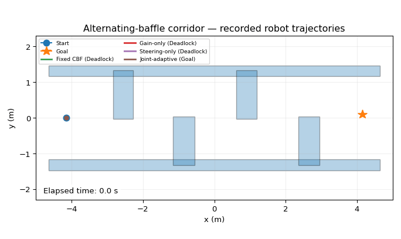
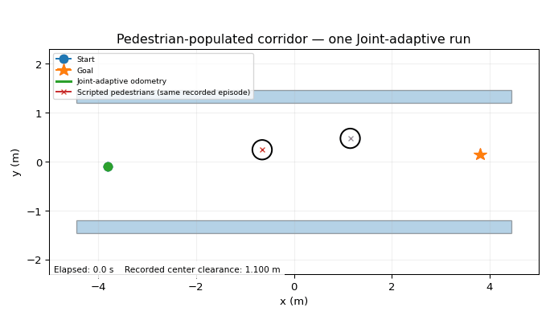
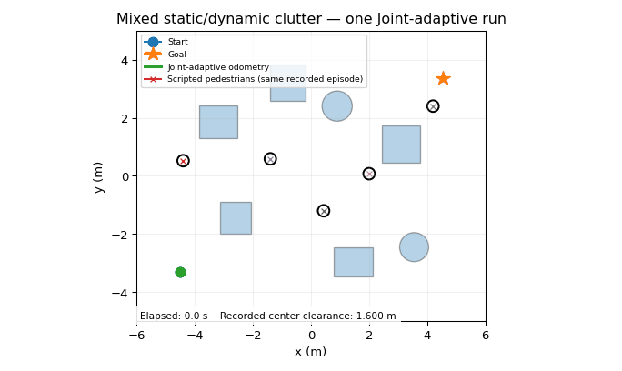
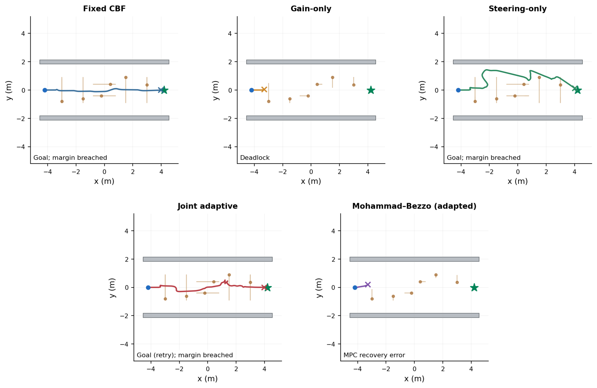
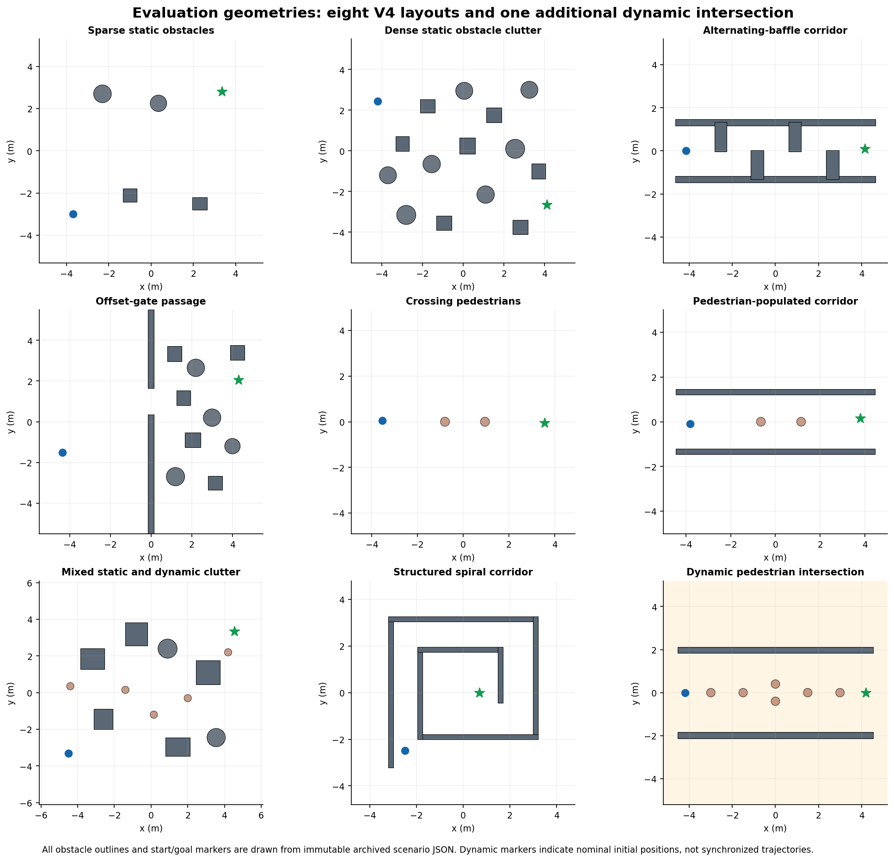
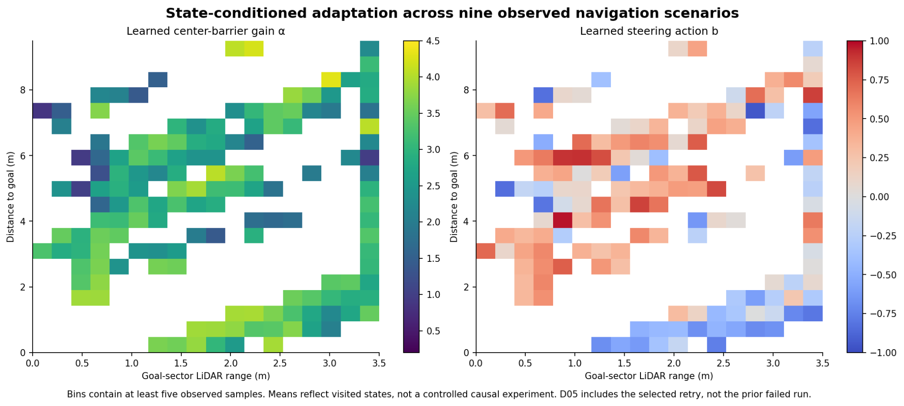

# Adaptive CBF–SAC Navigation for Mobile Robots

**Joint barrier-gain regulation and LiDAR-conditioned steering with a constrained velocity filter**

**Research implementation for:** *Adaptive CBF-SAC Navigation for Mobile Robots With LiDAR-Based Safety Filtering*  
**Authors:** Suleiman Diabat · Leszek Ambroziak · Ewa Pawluszewicz  
**Manuscript:** *Mechatronics*, manuscript MECH-D-26-00868 (revision-stage research package)

This repository contains the research software, trained SAC policies, Gazebo scenario definitions, frozen experimental records, figure-generation utilities, and audit information used to study **what changes when barrier-gain adaptation and obstacle-conditioned steering are learned jointly rather than individually**.

> **Scope:** This is a **research simulator and simulation-evidence repository**, not a plug-and-play or safety-certified physical-robot package. The mathematics is conditional; recorded LiDAR/model-state clearance thresholds are not independent physical collision measurements.

## Contents

- [Method and control flow](#method-and-control-flow)
- [Recorded navigation demonstrations](#recorded-navigation-demonstrations)
- [Nine evaluation environments](#nine-evaluation-environments)
- [Controller ablations and quantitative results](#controller-ablations-and-quantitative-results)
- [Learned-policy and safety diagnostics](#learned-policy-and-safety-diagnostics)
- [Software stack and repository contents](#software-stack-and-repository-contents)
- [Reproducing available results](#reproducing-available-results)
- [Experimental scope and limitations](#experimental-scope-and-limitations)
- [Citation and provenance](#citation-and-provenance)

---

## Method and control flow

A policy trained with **Soft Actor-Critic (SAC)** observes two successive 72-direction LiDAR scans and 12 navigation/history variables, yielding a **156-dimensional observation**. It outputs two bounded *controller parameters*, **not** robot velocities:

$$
(a_k,b_k)\in[-1,1]^2, \qquad
\alpha_k = 0.2+2.15(a_k+1)\in[0.2,4.5]\;\mathrm{s}^{-1}.
$$

- **Gain action** `a`: adjusts the forward-speed restriction imposed by the robot-center CBF.
- **Steering action** `b`: blends goal-directed yaw with a signed steering reference, gated by the LiDAR goal-sector distance. The gate also influences nominal speed selection through the heading-dependent nominal controller.
- **Safety-filtering cascade**: up to 18 selected LiDAR surface points are used in a center-speed cap, a *coupled* linear/angular lookahead CBF quadratic program (QP), and a subsequent nine-sample rollout guard. Only the **final post-guard command** is sent to `/cmd_vel`.

```text
       /scan (72 bins × 2 scans) + /odom + goal/history
                           │
                    156-D observation
                           │
                Trained SAC actor
                    (aₖ, bₖ)
                     /     \
              αₖ gain    gated steering bₖ
                  │          │
       center-CBF speed   nominal v, ω
                  \          /
             coupled lookahead CBF–QP
                  (v_QP, ω_QP, δ)
                           │
                sampled rollout guard
                           │
                      /cmd_vel
```

The center and lookahead barrier surrogates are

$$
h_i^C=p_{x,i}^2+p_{y,i}^2-d_C^2,\quad d_C=0.25\;\mathrm m,
\qquad
h_i^L=(\ell-p_{x,i})^2+p_{y,i}^2-d_L^2,
$$

where $\ell=0.18\,\mathrm m$ and $d_L=0.34\,\mathrm m$. The ideal QP tracks the nominal command while imposing input bounds and relaxed lookahead inequalities. A shared nonnegative slack $\delta$ relaxes **lookahead** inequalities, not the separate center-speed cap.

### Four experimental controller configurations

| Controller | Learned CBF gain? | Learned steering? | Configuration |
|---|:---:|:---:|---|
| **Fixed CBF** | No | No | $\alpha=3.5,\ b=0$ |
| **Gain-only** | Yes | No | SAC controls $\alpha_k$; $b=0$ |
| **Steering-only** | No | Yes | $\alpha=3.5$; SAC controls $b_k$ |
| **Joint-adaptive** | Yes | Yes | SAC jointly outputs $(a_k,b_k)$ |

All four use the same nominal-control and safety-filtering architecture. The three learned configurations have **separately trained** policies, so a single trajectory is not a controlled counterfactual for another policy.

---

## Recorded navigation demonstrations

These **animated plots are reconstructed from frozen per-step Gazebo CSV records**, not from hand-drawn or synthesized robot paths. The robot motion is based on recorded odometry; static obstacles come from the archived scenario geometry. Where pedestrians are shown, their positions come from **the same recorded execution**. They are **not videos of Gazebo**.

### Alternating-baffle corridor · four-controller ablation

Only the Joint-adaptive configuration reaches the target in the recorded four-controller ablation. The other three terminate in deadlock. The separate executions are aligned by *elapsed time*, not common robot states.



[See full five-panel trajectory comparison, including the adapted development comparator](docs/media/alternating_baffle_comparison.png)

### Pedestrian-populated corridor · simultaneous robot/pedestrian tracking

This depicts **one Joint-adaptive execution** together with the two pedestrian positions logged in that same episode. The four-controller ablation provides a useful counterexample: Steering-only deadlocks while Fixed CBF, Gain-only, and Joint-adaptive reach their goals.



[See four-controller recorded trajectory comparison](docs/media/pedestrian_ablation.png)

### Mixed static/dynamic clutter · successful goal with a margin breach

The Joint-adaptive execution reaches the goal; however, the recorded minimum robot-center clearance is **0.2476 m**, with **six samples below the 0.25 m design margin**. This animation shows the recorded robot and five scripted pedestrians from *one execution*. It is **not evidence of certified collision avoidance**.



[See time-resolved clearance and filter interventions](docs/media/mixed_clearance_response.png)

### Exploratory six-pedestrian intersection

A separate exploratory study uses a six-pedestrian corridor. The selected Joint-adaptive goal-reaching retry has **54 recorded center-margin violations**, and there is also an earlier Joint-adaptive deadlock. Neither run belongs to the frozen eight-layout benchmark.



---

## Nine evaluation environments

Eight primary development-inspected Gazebo layouts were evaluated with the four controller configurations. The ninth, **Dynamic pedestrian intersection**, is a **separate exploratory experiment** and is not pooled with the eight-layout results.



| Environment | Archive key | Scene characteristics | Evidence group |
|---|---|---|---|
| Sparse static obstacles | `R01` | Sparse stationary obstacles | Primary |
| Dense static obstacle clutter | `R02` | Multiple stationary shapes and restricted free space | Primary |
| Alternating-baffle corridor | `R03` | Wall-attached alternating obstructions | Primary |
| Offset-gate passage | `R04` | Offset opening between walls | Primary; locked revised geometry |
| Crossing pedestrians | `R05` | Moving pedestrian encounters | Primary |
| Pedestrian-populated corridor | `R06` | Two scripted moving pedestrians in a corridor | Primary |
| Mixed static/dynamic clutter | `R07` | Large static obstacles and five moving pedestrians | Primary |
| Structured spiral corridor | `R09` | Constrained inward turning path | Primary |
| Dynamic pedestrian intersection | `D05` | Six scripted pedestrians in a two-wall passage | **Exploratory only** |

**Geometry sources:** eight locked `.world` + `.json` pairs are under [`scenarios/`](scenarios/). The internal keys connect the paper's descriptive names to archived filenames; they are not separate method variants. Dynamic-obstacle phases are not assumed to be matched across independently executed controller episodes.

---

## Controller ablations and quantitative results

### Primary eight-layout evaluation (one archived run per controller × layout)

Legend: **G** = goal reached with all recorded center-clearance samples ≥ 0.25 m; **G\*** = goal reached but the margin was breached; **D** = terminated in deadlock. None of these codes is an independently measured physics-contact label.

| Environment | Fixed CBF | Gain-only | Steering-only | Joint-adaptive |
|---|:---:|:---:|:---:|:---:|
| Sparse static obstacles | G | G | G | G |
| Dense static clutter | D | D | G | G |
| Alternating-baffle corridor | D | D | D | **G** |
| Offset-gate passage | D | D | G | G |
| Crossing pedestrians | D | D | G | G |
| Pedestrian-populated corridor | G | G | D | **G** |
| Mixed static/dynamic clutter | D | D | G | **G\*** |
| Structured spiral corridor | D | D | G | G |
| **Goal completion** | **2/8** | **2/8** | **6/8** | **8/8** |
| **Goal with recorded margin respected** | **2/8** | **2/8** | **6/8** | **7/8** |

These eight environments were inspected or revised during development and are not a blind held-out population sample. The table documents a **descriptive improvement in goal completion**, not statistically established universal superiority.

### Separate 12-layout × 3-seed assessment

| Controller | Seed 41 | Seed 42 | Seed 43 | Total |
|---|---:|---:|---:|---:|
| Fixed CBF | 7/12 | 7/12 | 7/12 | **21/36** |
| Gain-only | 7/12 | 7/12 | 7/12 | **21/36** |
| Steering-only | 8/12 | 8/12 | 8/12 | **24/36** |
| Joint-adaptive | 9/12 | 8/12 | 9/12 | **26/36** |

The three seeds index independent training runs for learned configurations; Fixed CBF has no learned weights. Layouts are reused across seeds, so **144 observations do not imply 144 independent trained controllers**. Joint-adaptive and Steering-only both have **3/12** goal completions in the difficult category. The descriptive aggregate difference between Joint-adaptive and Steering-only is **2/36 = 5.56 percentage points**.

### What the comparison supports

- **Distinct roles:** barrier gain changes permissible forward approach speed; learned steering changes the nominal heading response.
- **Complementarity is environment-dependent:** the alternating-baffle case requires the combined learned configuration in the archived ablation, whereas the pedestrian corridor exposes a failure of Steering-only.
- **Goal completion is not safety certification:** Joint-adaptive reaches all eight primary goals but breaches the recorded 0.25 m margin in one.
- **Paired tests are exploratory:** exact McNemar comparisons with Holm correction give adjusted goal-completion p-values **0.09375** (vs Fixed), **0.09375** (vs Gain-only), and **0.50** (vs Steering-only). None is below 0.05.

### Exploratory dynamic-intersection accounting (separate evidence)

| Controller / attempt | Result | Minimum recorded center clearance | Samples below 0.25 m |
|---|---|---:|---:|
| Fixed CBF | Goal | 0.151 m | 21 |
| Gain-only | Deadlock | 0.113 m | 23 |
| Steering-only | Goal | 0.134 m | 21 |
| Joint-adaptive — earlier execution | Deadlock | 0.064 m | 74 |
| Joint-adaptive — selected retry | Goal | **0.0856 m** | **54** |

This exploratory series is reported separately and cannot be counted as an additional independent primary-benchmark goal. Its dynamic encounters were not time-synchronized across controllers.

---

## Learned-policy and safety diagnostics

### State-conditioned adaptation

The SAC actor conditions its action on the **full 156-dimensional observation**. The chart below projects *visited-state averages* onto two interpretable variables. It does **not** establish that the policy uses only these two inputs or that the plotted correlations are causal.



### Measurement and optimization settings

| Quantity | Configuration |
|---|---:|
| Command period | 0.20 s (nominal 5 Hz) |
| Gazebo physics integration step | 0.001 s (configured) |
| Forward command bound | 0–0.22 m/s |
| Angular command bound | ±2.63 rad/s |
| Policy input | 156 = 72 + 72 LiDAR ranges + 12 features |
| Selected LiDAR safety points | At most 18, one per sector |
| Selected-point search radius | 1.6 m |
| LiDAR longitudinal offset (simulated geometry) | −0.032 m |
| Center-margin distance | 0.25 m |
| Lookahead reference offset / margin | 0.18 m / 0.34 m |
| Center CBF gain (learned) | 0.2–4.5 s⁻¹ |
| Lookahead CBF coefficient | 2 s⁻¹ |
| QP objective weights (v, ω, δ) | (8, 0.5, 60) |
| QP numerical method | Fixed-budget dual-coordinate projection; 100 sweeps |
| Post-QP rollout guard | 9 sampled instants per 0.20-s interval |

The ideal relaxed-QP formulation admits a unique optimizer under the stated feasibility conditions. That mathematical property **does not validate** finite-iteration solver convergence, the post-guard residual, inter-sample clearance, or obstacle motion. A positive lookahead slack indicates relaxation of a constraint, **not** a confirmed collision.

### SAC training records

| Setting | Value |
|---|---|
| Actor / twin critics | Two hidden layers × 256 ReLU units |
| Training framework | Custom PyTorch SAC in a lightweight 2-D simulator |
| Optimizer / learning rate | Adam / 3×10⁻⁴ |
| Discount / target update | γ = 0.99 / τ = 0.005 |
| Replay buffer / minibatch | 200,000 / 512 |
| Parallel simulation environments | 16 |
| Random-action warmup | 5,000 frames |
| Training budget | 300,000 frames per learned policy |
| Independent training seeds | 41, 42, 43 |
| Stored model selection | Final saved `latest.pt`, **not** best checkpoint ranked on Gazebo results |
| Evaluation | Deterministic action inference; no policy updates |

There are **nine SAC checkpoints** (Gain-only, Steering-only, Joint-adaptive × three seeds). The Fixed CBF controller has no learned checkpoint.

---

## Software stack and repository contents

**Inspected research stack:** Ubuntu 22.04 · ROS 2 Humble · Gazebo Classic 11 · Python 3.10 · PyTorch · NumPy · pandas · Matplotlib. Exact dependency versions may vary with the recorded environment; the available repository does not establish a verified fresh-machine, one-command ROS/Gazebo reproduction.

```text
.
├── README.md
├── src/
│   ├── cbf_v3/             # SAC, scan geometry, steering and safety filter
│   └── gazebo_v31/         # ROS 2 / Gazebo transfer bridge and runners
├── checkpoints/            # 9 trained models and training logs
├── scenarios/              # 8 locked Gazebo world/JSON pairs
├── REPRODUCIBILITY/
│   ├── data/               # Archived experimental and derived evidence
│   └── scripts/            # Verification and publication-figure scripts
├── PAPER_MAIN/             # Publication plots, captions and table resources
├── FIGURE_MANIFEST.csv
├── SCENARIO_LOCK.csv
├── SOURCE_COVERAGE.csv
├── requirements_figures.txt
├── docs/
│   ├── media/              # README screenshots and recorded-motion GIFs
│   └── animation_sources/  # Frozen CSV/geometry subset used by the GIFs
└── scripts/
    └── regenerate_readme_gifs.py
```

### Main implementation files

| Component | Source path | Responsibility |
|---|---|---|
| SAC policy and checkpoint loading | `src/cbf_v3/sac.py` | Learned actor, inference and training code |
| LiDAR point processing | `src/cbf_v3/geometry.py` | Sector selection and coordinate conversion |
| Nominal steering | `src/cbf_v3/steering.py` | Goal tracking and learned steering gate |
| CBF-QP + rollout guard | `src/cbf_v3/filter.py` | Constraint-based command filtering |
| Policy/command interface | `src/gazebo_v31/transfer_core.py` | Frozen policy-to-controller adaptation |
| ROS 2/Gazebo interface | `src/gazebo_v31/gazebo_bridge.py` | `/scan`, `/odom`, `/cmd_vel` and experiment logging |
| Moving actors | `src/gazebo_v31/dynamic_actor.py` | Scripted pedestrian actors |
| Figure reproduction | `REPRODUCIBILITY/scripts/generate_selected_figures.py` | Regenerate selected paper plots |
| Evidence verification | `REPRODUCIBILITY/scripts/verify_evidence.py` | Check archived research evidence |

---

## Reproducing available results

### 1. Clone and inspect

```bash
# Replace with the actual GitHub owner/repository URL.
git clone https://github.com/OWNER/Adaptive-CBF-SAC-Navigation.git
cd Adaptive-CBF-SAC-Navigation
```

Private repositories require explicit collaborator access. `OWNER` is a placeholder.

### 2. Recreate available figures and verify records

```bash
python3 -m pip install numpy pandas matplotlib pillow
python3 REPRODUCIBILITY/scripts/verify_evidence.py
python3 REPRODUCIBILITY/scripts/generate_selected_figures.py
```

The verification and figure scripts depend on the evidence files being in their expected locations. The outputs should be cross-checked against [`FIGURE_MANIFEST.csv`](FIGURE_MANIFEST.csv) and [`SOURCE_COVERAGE.csv`](SOURCE_COVERAGE.csv).

### 3. Rebuild the three README animations

The accompanying animation-source subset contains the original selected per-step files, same-episode pedestrian logs and archived scenario geometry used in the GIFs:

```bash
python3 scripts/regenerate_readme_gifs.py
```

The animations depict **logged trajectories**, not Gazebo camera recording. The baffle comparison aligns independent episodes by elapsed time; each moving-person animation uses matched robot/person records **within one execution**. The GIFs are illustrative analyses of recorded results, not extra trial observations.

### 4. ROS 2 / Gazebo and physical robot use

The original Gazebo integration is under `src/gazebo_v31/`. The controller consumes `/scan` and `/odom` and publishes commands through `/cmd_vel`, using checkpoints from `checkpoints/` for learned modes. The repository records the experimental controller, **but a verified install-and-launch recipe on a fresh host has not yet been demonstrated**. Do not assume shell runners can be invoked unchanged without checking their ROS environment, working directories and launch arguments.

**Physical TurtleBot3 operation:** the Gazebo bridge must first be adapted and validated against the robot's actual LiDAR mounting, time synchronization, actuator interface, emergency stop and independent collision monitoring. **Do not interpret this repository as a safety-approved real-robot launcher.**

